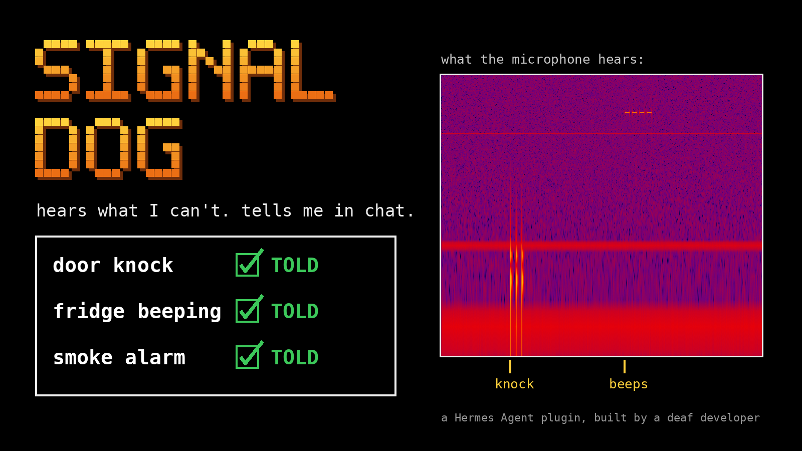
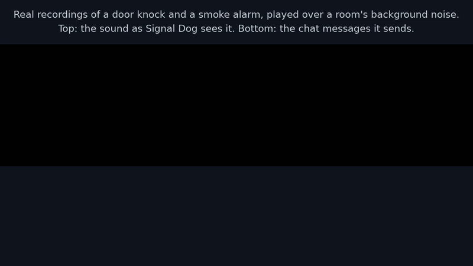
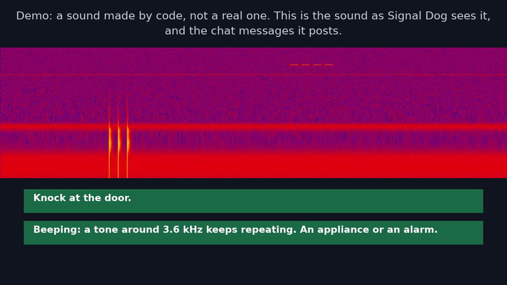
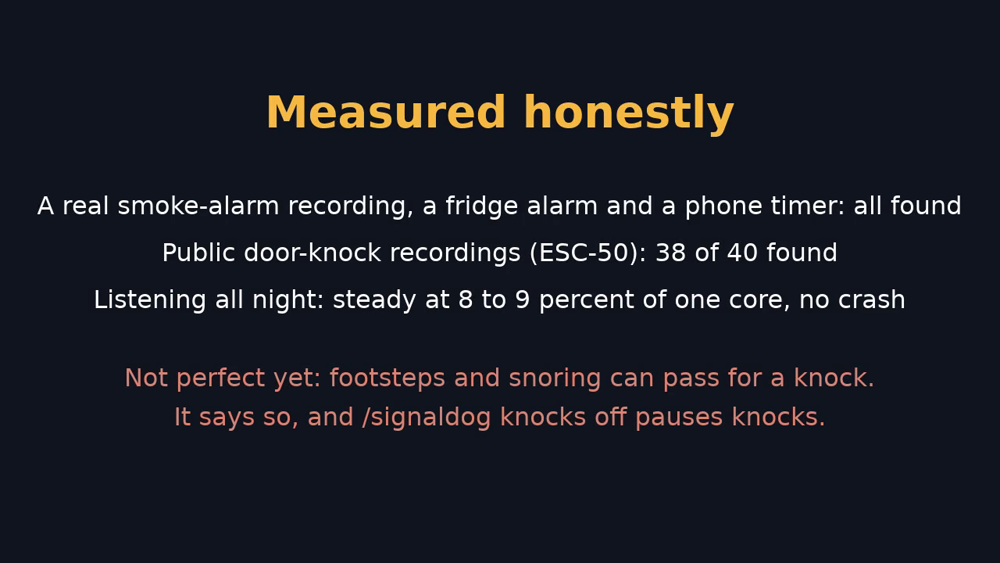

# Signal Dog

**Listens through your computer's microphone for a knock at the door, an appliance beeping or a smoke alarm, and tells you in your Hermes chat. Built by a deaf developer for his own home.**



**Demo video (68 seconds):** https://x.com/ScottLeimroth/status/2119318814991188312



A Hermes Agent plugin that listens through your computer's microphone for household
sounds and tells you in chat when it hears one:

- a **knock at the door**
- an **appliance beeping** (a fridge door alarm, a phone timer, an oven)
- a **smoke alarm**, or any steady tone that goes on for seconds

A signal dog is a dog trained to alert a deaf person to sounds. This does the same job
with a microphone. It is built by a deaf developer, for use at home.

Not a certified smoke alarm. Do not rely on it for safety.



## What you see

In the chat where you switched it on:

> Knock at the door.
>
> Beeping: a tone around 3.6 kHz keeps repeating. An appliance or an alarm.
>
> A steady tone around 2.9 kHz has been sounding for 12 seconds. An appliance or an alarm.

No microphone? `/signaldog demo` plays a short recording made by code through the real listener
and posts what it finds, each message labelled DEMO. It needs only `ffmpeg`.

## Why a plugin (not a skill or prompt)

A skill or a prompt can only shape what the model says when someone talks to it. Signal Dog has to listen all the
time, including when nobody is chatting: it runs `ffmpeg` in the background, turns the sound into 64 numbers 100
times a second, and posts into your chat by itself the moment it hears a knock or an alarm. It also gives the agent
a tool to answer "what did you hear while I was out?", and slash commands to switch it on, check on it, pause knocks
and mark alerts right or wrong. None of that is possible from a prompt. No extra model: the rules are plain Python.

## Why not use the phone

Phones can already recognise some sounds, including knocks, alarms and appliance beeps.
Signal Dog does not claim to hear better than a phone, and it has not been compared with
one. It is different in three ways:

- It stays at home, listening, when your phone is somewhere else.
- It reports inside the agent you already talk to, and you can ask that agent what it
  heard. Delivery has been tested on Hermes's local chat and on Matrix (a test Matrix
  server set up for it, without encryption). No other messaging app has been tested.
- It is open and small enough to read in an afternoon, and the thresholds are yours to
  change.

## Use

For live listening it needs `ffmpeg` and a microphone:

- **Linux and WSL2:** through PulseAudio. A static `ffmpeg` build without PulseAudio will start but cannot open the
  microphone; the plugin then says so in `/signaldog status`.
- **Windows (native):** through DirectShow. `default` is the first microphone `ffmpeg` lists; to choose another, set
  `source` to a name from `ffmpeg -list_devices true -f dshow -i dummy`. Tested live on a Windows PC's webcam microphone,
  including the reader swap and a clean stop.
- **macOS: not yet.** On a test Mac the microphone reached Signal Dog with most of the sound missing, so on a Mac
  `/signaldog on` says so and does nothing. `/signaldog demo` and the agent's tool work there, and the tests pass on macOS.

Machines with no microphone can run `/signaldog demo`, which needs `ffmpeg` but no microphone. The tests run on
Linux, macOS and Windows (`.github/workflows/tests.yml`).

Put this folder at `$HERMES_HOME/plugins/signal-dog` and enable it:

```
git clone https://github.com/scottleimroth/signal-dog "$HERMES_HOME/plugins/signal-dog"
hermes plugins enable signal-dog
```

Run its tests with `python3 -m unittest discover -s tests` (standard Python; the demo and recording tests need `ffmpeg`).

Then, in the chat where you want alerts:

| Command | What it does |
|---|---|
| `/signaldog on` | Start listening; alerts are posted in this chat |
| `/signaldog off` | Stop listening |
| `/signaldog status` | Is it alive, when did it last hear numbers, did alerts get through |
| `/signaldog test` | Send a test message by the same route alerts use |
| `/signaldog wrong [note]` | Mark the latest alert (from the last 24 hours) as a false alarm; the note is optional |
| `/signaldog right [note]` | Mark the latest alert as a real one |
| `/signaldog demo` | Play a short recording made by code through the real listener, with no microphone |
| `/signaldog knocks off` / `on` | Pause knock messages (for example while you cook), or bring them back; beeps and alarms still come |

**Marks.** `wrong` and `right` write one line to the numbers log (see below) with the
alert's kind, pitch and time and your verdict. Marking the same alert again replaces the
earlier mark. A mark changes nothing about what Signal Dog detects: it is a record for
you, and `/signaldog status` shows how many alerts still in the log you marked right and
wrong. If there is no alert to mark, it says so.

**Demo.** `/signaldog demo` makes a 14 second recording by code (a knock, then four beeps
at about 3.6 kHz), plays it through the same `ffmpeg` graph, detector and delivery as live
listening, and posts what it finds in the chat. Every message is labelled `DEMO (not a
real sound)`, nothing is added to the numbers log, and the counts in `/signaldog status`
are untouched. It stops by itself, or with `/signaldog off`. It will not run while live
listening is on, and it says so if `ffmpeg` is missing. It needs the same owner rights as
the other commands.

**Asking the agent.** The plugin gives the agent one read-only tool,
`signal_dog_recent_alerts`. Ask "what did you hear while I was out?" and the agent can
read the plugin's numbers log: each recent alert with its time, kind, pitch and your
mark, and whether Signal Dog is listening now. It never reads audio, makes no network
call, and does not return your notes. If Signal Dog is off, or has only just been
switched on, the answer says so, because an empty list then proves nothing. The log
rotates (it keeps only its newest part), so older alerts are gone.

It is off until you turn it on. Every 24 hours it posts "still listening", or says that
it is not, so a dead listener is never silent. Settings: `source` (which microphone,
default the system default), `heartbeat_hours` (0 turns the daily message off),
`recycle_minutes` (see below) and `owner_ids`.

**Why it replaces its microphone reader every 10 minutes.** On a live microphone, one `ffmpeg`
process slowly uses more processor the longer it runs (measured on the capture alone, so it is
not the plugin's own filters): about 5 percent of a core when fresh and over 10 percent after 40
minutes, and still rising. So every `recycle_minutes` (default 10, 0 turns it off) the plugin
starts a second `ffmpeg` beside the first, lets it learn the room for a few seconds, waits until
the first is not in the middle of a knock or a run of beeps, then switches over and stops the
old one. For those few seconds two readers share the microphone. Nothing is lost at the swap.
With the swap on, an 8.5-hour overnight run stayed at 8 to 9 percent of one core the whole time.

**Who can use it.** On your own machine (CLI, TUI, Desktop), whoever is at it. In a messaging
chat, only the owner: anyone listed in `owner_ids`, or, if that is empty, the first person
to switch it on from a direct message. In a group chat it will not switch on for anyone
not listed. Alerts go only to the chat it was switched on in.

**If an alert cannot be delivered,** it is kept and sent later as one "Missed while this chat
was disconnected" message: when a retry works (every minute), when you next run a
`/signaldog` command, or, on your own machine, when you next send a message. `/signaldog
status` shows what is waiting.

## How it works

`ffmpeg` listens to the microphone and splits the sound into 64 narrow bands. It turns
each band into a number, 100 times a second, and hands those numbers to Python. Python
never receives or stores sound. A small set of rules then looks for a pattern:

- **Knock:** three low thuds that are evenly spaced (about a quarter of a second apart),
  alike in strength and loud, mostly without sharp clicks in them. When there has been a lot of
  thumping nearby in the last 30 seconds (someone typing, cooking or walking about), one set is
  not enough: it waits for a second set within 20 seconds, because people at a door knock again,
  and the message says the room was busy. Each thud must also be struck: it reaches full loudness within about 50 ms,
  as a knuckle on a door does, where typing, footsteps and snoring mostly build up more slowly. In a quiet room two dull
  thuds are enough. A single
  hit is not a knock, and a hand on a desk or a mug put down hard usually is not either.
- **Beep:** a narrow band that stands out from the bands around it and from its own
  usual level, repeating three times at evenly spaced moments (within 80 milliseconds of
  each other) in eight seconds, or holding for three seconds. Steady tones, such as the
  whine of a fan, are learned as part of the room and ignored. When the room is busy
  (television, talking), evenly spaced beeps turn up by chance, so it asks for more: a
  fifth beep in the same rhythm, or a second separate set a little later, and the beeps
  must be long enough (at most one shorter than 240 ms). A real alarm keeps going, so this
  delays it and does not lose it. Alerts that came through this route say the room is
  noisy, because you cannot hear whether they were right.

No Python packages are needed. See `docs/DETECTOR-DESIGN.md`.

## What it does with your data

- **Microphone:** while switched on, it listens to the microphone continuously.
- **Background process:** it runs one `ffmpeg` process (two for about 30 seconds every
  `recycle_minutes`, while one replaces the other), and stops them when you turn the
  plugin off or it unloads. `/signaldog demo` runs one more `ffmpeg` for about 15
  seconds. `ffmpeg` must already be installed; the plugin never downloads anything.
- **Audio from the microphone is never kept.** It is analysed in memory and dropped, and
  there is no option to keep it. The one file of sound the plugin ever writes is the
  demo's: a recording made by code (a knock and beeps, no real sound), written to a
  private temporary folder when you run `/signaldog demo` and deleted when the demo ends.
- **What is kept:** a small log of times, levels and what was detected, in
  `$HERMES_HOME/signal-dog/events.log`, limited in size (when it reaches 256 KB it is
  moved to `events.log.1`, replacing the one before). It contains numbers only, with one
  exception: the optional note you type after `/signaldog wrong` or `right`. That note is
  free text. It is cut to 80 characters and kept on one line, with extra spaces, `=`
  signs and control characters removed, but otherwise written as you typed it, so do not
  put anything private in it. It stays on your machine, and the agent's tool does not return it.
- **What the tool gives the agent:** `signal_dog_recent_alerts` reads that log and returns
  alert times, kinds, pitches, your right and wrong marks and the listener's state to
  the agent. Like any tool result, it goes to whatever model your agent uses. The tool does not
  check who is asking: anyone who can talk to your agent, in any chat it serves, can ask what
  the house heard, which also shows when it was quiet. Do not use Signal Dog on an agent that
  strangers can message.
- **Missed alerts:** up to 20 undelivered alert messages are held in memory only. A gateway
  restart or `/signaldog off` empties them.
- **Hook:** it uses `pre_llm_call` only to notice, on your own machine, which chat session is
  live. It reads no message content and adds nothing to the turn.
- **Network:** the plugin makes no network calls and has no telemetry. Alerts are chat
  messages delivered by the agent through the messaging app you already set up.
- **Secrets:** it reads and stores no credentials.

## What has been measured

Every number is from one house, one microphone, and, where marked, from the same recordings the rules were
tuned on, so it shows a direction, not a promise. `docs/DETECTOR-DESIGN.md` has the detail.

| Test | Result |
|---|---|
| House recordings: 3 visits to the door, 12 sets of knocks (tuned on) | every visit alerted; 9 of the 12 sets |
| House recordings: fridge door alarm, phone timer, a smoke-alarm sound played from a phone (tuned on) | 3 of 3 alerted |
| A public-domain recording of a real smoke alarm (Wikimedia Commons, 37 s) | alerted 4.5 s after the alarm began, and again as it kept sounding |
| The standard smoke-alarm pattern (three half-second beeps, a pause), made by code and mixed into room noise at four loudnesses | found in 2.3 to 2.7 s each time |
| 40 public door-knock recordings (ESC-50) mixed into room noise, loudest thud 25 dB over the room | 38 alerted (35 at 30 dB, 28 at 20 dB) |
| The same test with 240 recordings of other sounds (footsteps, typing, mouse clicks, clock ticks, a creaking door, a can opening), each as loud as the knocks | 43 raised a knock alert |
| The same test with 40 public snoring recordings | 22 raised a knock alert |
| 40 public alarm-clock recordings, same loudness | 26 raised a beep alert |
| Television on, 1.3 hours in several sittings (tuned on) | 5 beep alerts and 1 knock alert nobody asked for |
| An ordinary evening, television off, 35 minutes (tuned on) | 14 knock alerts nobody asked for, no beep alerts |
| 49 minutes at home, nobody at the door, recorded after the knock rules were written (32 of them helped set the strike limit) | 14 knock alerts nobody asked for, down from 48 without the two knock checks |
| A quiet house overnight, television off, 8 hours (not tuned on) | 7 soft knock alerts (snoring is the likely cause) and 1 beep alert, cause unknown |
| Running all night with its reader swapped every 10 minutes | 8.5 hours, 8 to 9 percent of one processor core, no crash |



The public-recording test is `tools/public_clips.py`; the ESC-50 set (Piczak 2015,
https://github.com/karolpiczak/ESC-50) is not in this repository. The house recordings are not either.

## Limits, honestly

- It can miss sounds and it can raise false alerts. Knock alerts are the weaker side: Signal Dog hears
  "something thumped three times", not "someone is at the door". Footsteps, typing, mouse clicks, a creaking
  door and snoring can all do it when they are loud and close (see the table). On an ordinary evening at home, awake
  and with no visitors, it raised 82 knock alerts in 133 minutes, every one of them false (before the two knock checks). In a room busy with thumps it waits
  for a second set of knocks and says the room was busy, and every knock must be struck (full loudness within about 50 ms).
  Together these cut false knock alerts at home by about 70 percent (48 to 14 in 49 fresh minutes), but do not end them; while
  you cook or tidy, `/signaldog knocks off` pauses knock messages and keeps the beeps.
- With the television on, only the three-thud route works, and a knock has to be loud (at least 20 dB above
  the room). Soft knocks and two-knock knocks are missed then, and for up to two minutes after the television goes
  quiet, because the two-thud route stays off while the beep side calls the room busy. The 20 dB comes from one house.
- A loud, sudden sound that is dull and repeats twice, close to the microphone, can look like a knock in a quiet room.
- With the television on, a beep alert can come about two minutes after a fridge door
  alarm starts, because it waits for a second set; a phone timer or smoke alarm sound took
  a few seconds. A single set of three beeps with the television on (a microwave) is not
  alerted. Repeats slower than one every 4 seconds are never alerted, and slower than
  2.4 seconds are not alerted with the television on. Clocks that tick evenly look like beeps: 14 of 40 public
  clock-tick recordings raised a beep alert.
- Beep false alerts with the television on were about 4 an hour in the recordings above (the target was 1).
  Beep alerts raised in a noisy room say so.
- A smoke alarm that keeps sounding raises a new message about every 10 seconds.
- Beeps shorter than about 0.16 seconds are mostly missed (some carbon-monoxide alarms use 0.1 s beeps). A made-up pattern of four 0.1 s beeps was found
  only in a very quiet room.
- It listens only where the agent runs. It cannot hear a different room or house.
- A gateway restart stops the listener and empties the missed alerts. Run `/signaldog on`
  again after one.
- The agent's tool (`signal_dog_recent_alerts`) has been used by a live Hermes agent on a local model: asked in plain
  words what the house heard, it found the tool, called it and answered with the right times and pitch. Hermes finds
  the tool by keywords, so a model that searches with a whole question rather than keywords may not find it.
- In a very echoey room a knock can land on the echo of the one before and be missed: with echo added to the public
  knocks, 33 of 37 (room echo) and 28 of 37 (hall echo) still alerted.
- Delivery has been tested on two routes only: Hermes's local chat, and Matrix in an
  unencrypted room on a throwaway server (with a network outage and a `/new`). Every other
  messaging app, and encrypted rooms, have not been tested.
- It does not replace a certified smoke alarm.

## Licence

MIT. See `LICENSE`.
